# p0/scaffold-design-system

Commit `1ad24ef`, run 43175528498.

## appearanceDark.appearance-dark

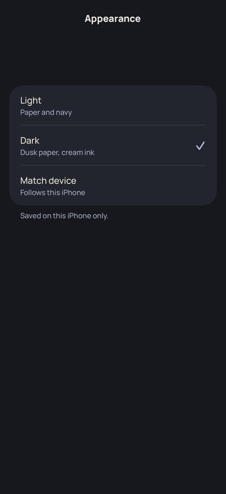

## appearanceLight.appearance-light

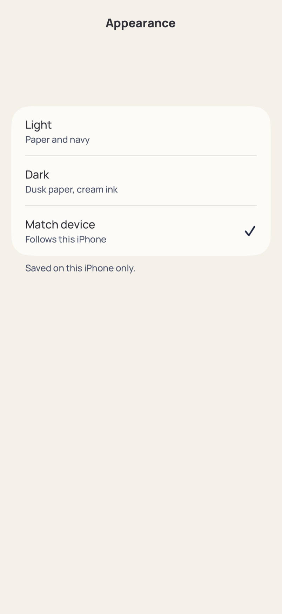

## catalogDark.catalog-dark

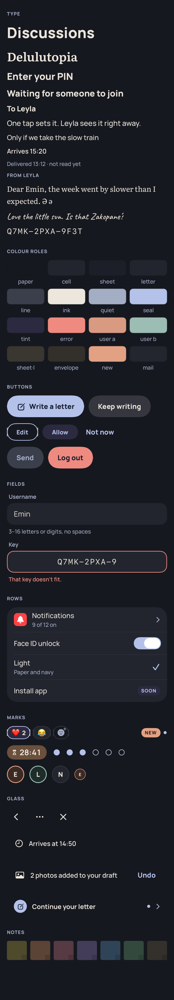

## catalogLight.catalog-light

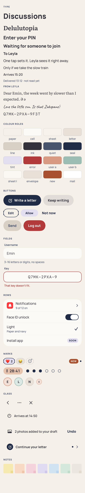

## glassDark.glass-dark

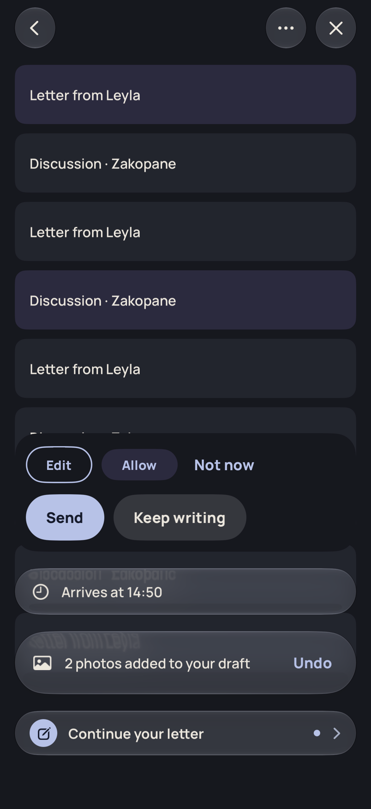

## glassLight.glass-light

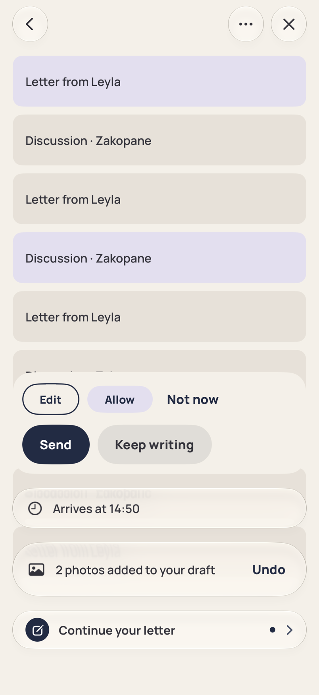

## homeDark.home-dark

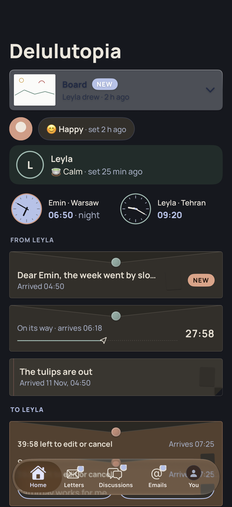

## homeLight.home-light

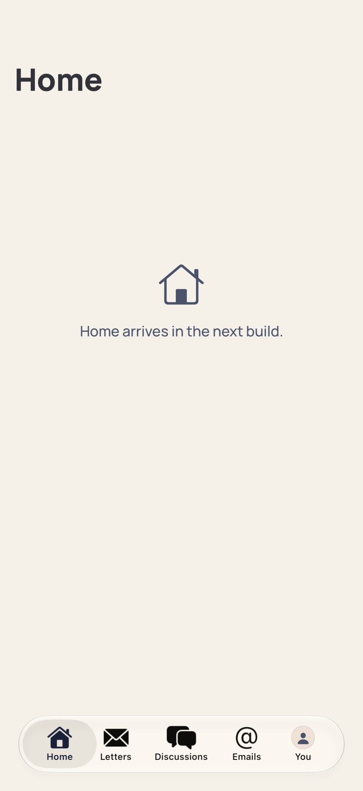

## lettersLight.letters-light

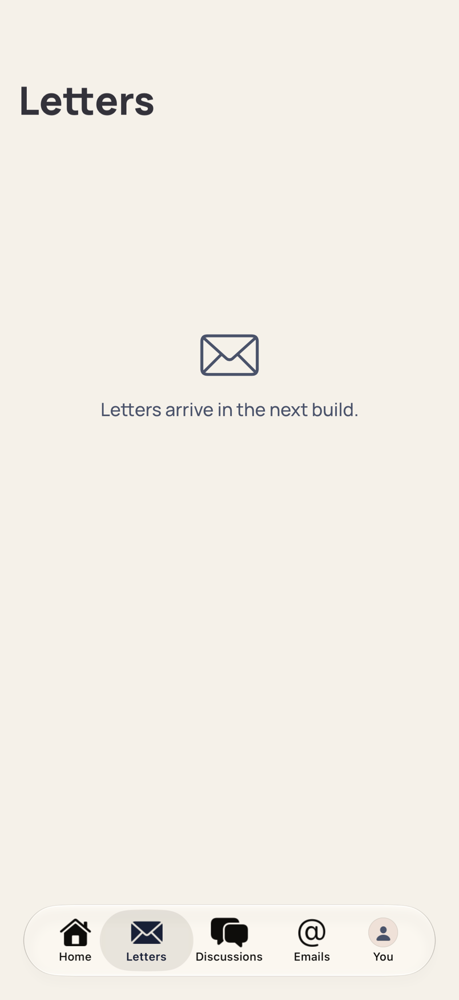

## youDark.you-dark

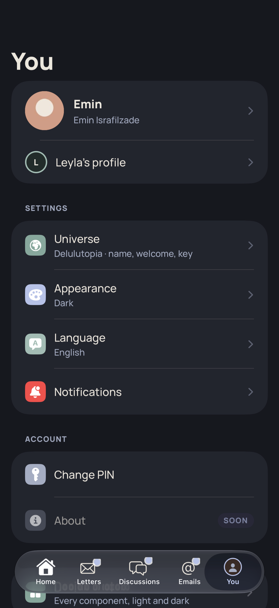

## youLight.you-light

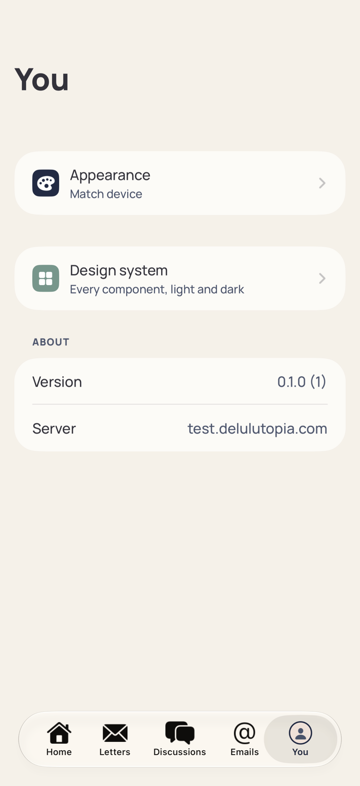

